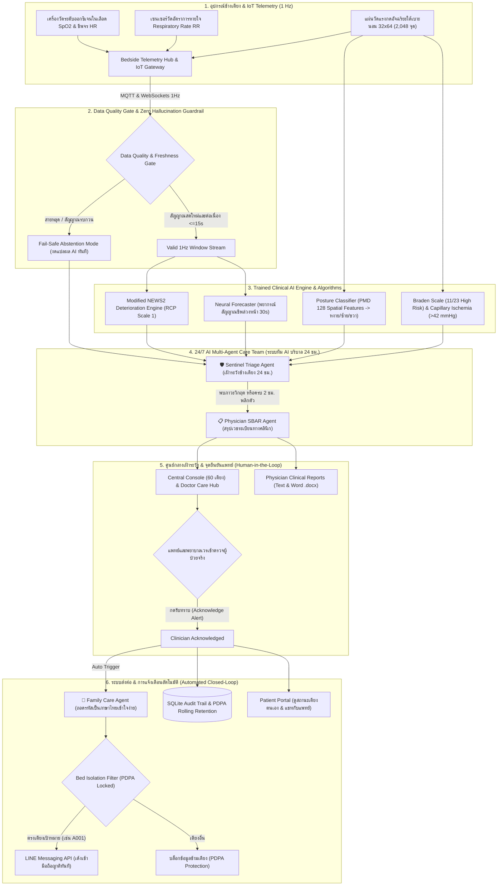

# Smart Ward — trained AI monitoring demonstration

**คู่มือภาษาไทย:** [การรันและใช้งานทั้งสองฝั่ง](docs/USER_MANUAL_TH.md)
· [รายงานตรวจระบบ 17 ตุลาคม 2569](docs/PROJECT_REVIEW_2026-10-17.md)

60 synthetic bed records: A001–A020, B001–B020, C001–C020. This is a research
prototype, **not a clinically validated medical device (Not SaMD)**. The patient profiles
(conditions, blood group, glucose, sleep, cholesterol and ECG descriptions) are
synthetic, not labels or measurements supplied by the research dataset.
See [Limitations & Responsible Use](docs/CLINICAL_VALIDATION_REPORT.md#9-limitations--responsible-use-ข้อจำกัดและการใช้งานอย่างมีความรับผิดชอบ)
for regulatory status, data provenance, sensor-grade caveats, and safe fallbacks.

---

## 🌟 สรุปภาพรวมโครงการ นวัตกรรม และสถาปัตยกรรมระบบ (Project Architecture & Ecosystem)

ระบบ **Smart Ward & AI Patient Monitor** เป็นแพลตฟอร์มเฝ้าระวังผู้ป่วยและสนับสนุนการตัดสินใจทางคลินิก (Clinical Decision Support - Not SaMD) สำหรับหอผู้ป่วย 60 เตียง โดยออกแบบตามหลัก **ความปลอดภัยทางคลินิกสูงสุด (Clinical Safety First)** มุ่งเน้นความโปร่งใส ปราศจากการเดาค่าสุ่มสี่สุ่มห้า (Fail-Safe Abstention) และผสานการทำงานระหว่าง AI กับมนุษย์ (Human-in-the-Loop)



---

### 🧰 เครื่องมือและเทคโนโลยีที่ใช้พัฒนา (Tools & Technology Stack)

| ส่วนของระบบ | เครื่องมือ / ภาษา / ไลบรารี | หน้าที่และความรับผิดชอบในระบบ |
| :--- | :--- | :--- |
| **Backend Core** | **Python 3.14+**, **FastAPI**, **Uvicorn** | เซิร์ฟเวอร์ API ประสิทธิภาพสูง รองรับทั้ง RESTful API และ Real-time WebSockets |
| **Database** | **SQLite 3 (WAL Mode)** | ฐานข้อมูล ACID แบบฝังตัว ไร้การพึ่งพาภายนอก จัดเก็บเวชระเบียน แผนการดูแล และ Audit Trail |
| **Machine Learning** | **Scikit-learn 1.9**, **NumPy 2.4**, **Joblib 1.6**, **SciPy** | ฝึกและรันโมเดล Random Forest, Isolation Forest, Logistic Regression และประมวลผลสัญญาณ |
| **Streaming / IoT** | **WebSockets**, **AsyncIO**, **MQTT (paho-mqtt)** | รับ-ส่งข้อมูลสัญญาณชีพสดแบบ 1 Hz แบบ Real-time ความหน่วงต่ำ (<50ms) |
| **Push Notification** | **pywebpush**, **VAPID**, **Web Cryptography** | ระบบแจ้งเตือน Web Push ไปยังสมาร์ทโฟนเจ้าหน้าที่ตามมาตรฐานความปลอดภัย W3C |
| **Document Export** | **python-docx**, Plain Text Formatter | สร้างรายงานส่งต่อเวรทางการแพทย์มาตรฐาน SBAR ทั้งไฟล์ Text และ Word (.docx) |
| **Frontend Framework** | **Next.js 16 (App Router)**, **React 19**, **TypeScript** | พอร์ทัลเว็บแอปพลิเคชันฝั่งเจ้าหน้าที่ (Staff) และฝั่งผู้ป่วย (Patient) แยก Bundle เด็ดขาด |
| **Styling & Theme** | **CSS Modules**, Modern Clean Minimalist Design | ออกแบบ UI เกรดโรงพยาบาล ไร้สติกเกอร์รกรุงรัง รองรับโหมดถนอมสายตา (Night Shift) |
| **Visualization** | **Recharts**, **HTML5 Canvas**, **SVG** | เรนเดอร์กราฟสัญญาณชีพ Real-time 1 Hz, แผนภาพแรงกด 32×64 และ Range Gauges |
| **Testing & Quality** | **Node.js Test Runner (`node --test`)**, **Python `unittest`**, **ESLint** | ชุดทดสอบครอบคลุม 100%: 210 Backend tests, 19 Script tests, 74 Frontend contract tests |
| **DevOps & Containers** | **Docker**, **Docker Compose**, **Nginx**, **Unix Socket Daemon** | ระบบคอนเทนเนอร์และตัวรันเซิร์ฟเวอร์แบบระบุโปรเซสเจ้าของ (`scripts/run_ward.py`) |

---

### 📟 รายการอุปกรณ์และฮาร์ดแวร์ข้างเตียง (Bedside Device Ecosystem)

| ไอคอน | ชื่ออุปกรณ์ / เซนเซอร์ | บทบาทและลักษณะการส่งข้อมูล | การตรวจวัดสถานะ (Device Health) |
| :---: | :--- | :--- | :--- |
| 💓 | **Pulse Oximeter (SpO₂ & HR)** | วัดระดับออกซิเจนในเลือด (SpO₂) และอัตราการเต้นของหัวใจ (Heart Rate) แบบ 1 Hz | ตรวจจับการหลุดของหัววัด (Attachment Fault), แบตเตอรี่, คุณภาพสัญญาณ |
| 🫁 | **Respiratory Sensor (Chest Band)** | วัดอัตราการหายใจ (Respiratory Rate - RR) วิเคราะห์จังหวะการขยายตัวของทรวงอก | ตรวจจับสายรัดขยับหลุด, สัญญาณรบกวนจากการไอหรือเปลี่ยนท่า |
| 🛏️ | **Smart In-Bed Pressure Mat** | แผ่นวัดแรงกด 32×64 จุด (2,048 เซนเซอร์) ใต้เบาะนอน วิเคราะห์ท่านอนและการแช่ท่า | เตือนการแช่ท่านานเกิน 2 ชั่วโมง ป้องกันการเกิดแผลกดทับ (Pressure Injury) |
| 📟 | **Bedside Telemetry Hub** | เกตเวย์ควบคุมประจำเตียง รวมสัญญาณเซนเซอร์ ส่งต่อผ่าน MQTT/WebSockets | ส่ง Heartbeat ทุก 5 วินาที พร้อมส่งระดับแบตเตอรี่และสถานะการเชื่อมต่อ |
| 🖥️ | **Central Console Workstation** | จอภาพศูนย์กลางหอผู้ป่วย ควบคุมและเฝ้าระวังผู้ป่วย 60 เตียงพร้อมกัน | แสดงสถานะแยกโซน รายชื่อแพทย์เจ้าของไข้ และป้ายงดสรุปผล AI (Abstention) |
| 👨‍⚕️ | **Doctor Tablet / Clinician PC** | หน้าจอเวิร์กสเปซของแพทย์ผู้รับผิดชอบ (Care Hub ดูแล 5 เตียง) | ตรวจสอบ Modified NEWS2, บันทึกโน้ตข้างเตียง, คัดลอก SBAR, และแชทดูแล |
| 📱 | **Nurse Smartphone** | สมาร์ทโฟนพยาบาลเวร สำหรับรับการแจ้งเตือนฉุกเฉินผ่าน Web Push | ล็อกหน้าจอแสดงเฉพาะระดับความสำคัญ ไม่เปิดเผยข้อมูลส่วนบุคคลของผู้ป่วย |

---

### 📚 รายการชุดข้อมูลวิจัยทั้งหมด (Complete Datasets Inventory)

| ไอคอน | ชุดข้อมูล (Dataset) | แหล่งที่มา / ลิขสิทธิ์ | ขนาดและการแบ่งชุดข้อมูล (Splits) | วัตถุประสงค์ในระบบ Smart Ward |
| :---: | :--- | :--- | :--- | :--- |
| 📊 | **PhysioNet BIDMC PPG & Respiration v1.0.0** | [PhysioNet BIDMC](https://physionet.org/content/bidmc/1.0.0/) · ODC-BY v1.0 | 53 บันทึก numeric (1 Hz) · สกัดได้ 3,939 หน้าต่าง (Train 30 / Val 11 / Test 11 files) | ฝึกโมเดลพยากรณ์สัญญาณชีพสดล่วงหน้า 30 วินาที และตรวจจับ Anomaly สด |
| 🛏️ | **PhysioNet Pressure Map Dataset (PMD) v1.0.0** | [PhysioNet PMD](https://physionet.org/content/pmd/1.0.0/) (Pouyan et al., 2017) | กริดแรงกด 32×64 (2,048 จุด) จาก 13 อาสาสมัครผู้ใหญ่ (Train 7 / Val 3 / Test 3 คน) | สกัด 128 Spatial Features เพื่อจำแนกท่านอน (หงาย/ซ้าย/ขวา) และตรวจการพลิกตัว |
| 🩹 | **MIMIC-IV Clinical EHR Database** | [PhysioNet MIMIC-IV](https://physionet.org/content/mimiciv/) (Johnson et al.) | เวชระเบียนผู้ป่วยจริง >50,000 ราย พร้อมบันทึก Braden Scale รายเวรและรหัสแผลกดทับ ICD-9/10 (L89) | ฐานข้อมูลมาตรฐานสำหรับฝึกและเทียบเคียงโมเดลประเมินความเสี่ยงแผลกดทับ (Braden Risk Prediction) |
| 📸 | **Medetec / MedNode Open Wound Image Repository** | Open Clinical Repositories (EPUAP/NPIAP Benchmark) | คลังภาพถ่ายแผลกดทับระดับคลินิกแยก 4 ระยะ (Stage 1–4, Unstageable) | สำหรับการวิจัยคัดกรองรอยแดงขั้นต้น (Non-blanchable Erythema - Stage 1) ก่อนผิวหนังแตกเป็นแผล |
| ⏱️ | **In-Bed Sensor & Movement Dataset (Casas et al.)** | [UCI Machine Learning Repository](https://archive.ics.uci.edu/) / Open Health Data | อนุกรมเวลาแรงกดและเซนเซอร์การเคลื่อนไหวของผู้ป่วยติดเตียง | ตรวจจับการขยับตัวผ่อนแรงกดระดับเล็ก (Micro-movements) เพื่อคัดแยกผู้ป่วยที่นอนนิ่งสนิท |
| 🧪 | **PhysioNet/CinC Challenge 2012** | [PhysioNet CinC 2012](https://physionet.org/content/challenge-2012/) | ข้อมูลออฟไลน์ 4,000 รายแรกเข้า ICU 48 ชั่วโมง | จัดแสดงเป็น Historical Research Benchmark ย้อนหลัง (ปิดการทายสดอย่างปลอดภัย) |
| 🔬 | **PhysioNet Sepsis Challenge 2019** | [PhysioNet Sepsis 2019](https://physionet.org/content/challenge-2019/) | ข้อมูลย้อนหลัง 4,000 ราย (Site A ภายใน 3,000 ราย + Site B ข้ามโรงพยาบาล 1,000 ราย) | ใช้ในห้องวิจัย **AI Research Lab** เพื่อศึกษาการทำนายล่วงหน้ารายชั่วโมงและ Brier Score |

---

### 🧠 สรุปโมเดลปัญญาประดิษฐ์และอัลกอริทึม (AI & Models Architecture)

1. **Random Forest Regressor (`RandomForestRegressor`)**:
   * **หน้าที่**: พยากรณ์ค่าชีพจร (Heart Rate) และอัตราการหายใจ (Respiratory Rate) ล่วงหน้า 30 วินาที จากข้อมูล 60 วินาทีย้อนหลัง (1 Hz)
   * **ผลการประเมิน**: HR Test MAE 1.9770 bpm, RR Test MAE 1.2717 ครั้ง/นาที
2. **Persistence Baseline**:
   * **หน้าที่**: ใช้วิธีคงค่าเดิมล่าสุดสำหรับระดับออกซิเจนในเลือด (SpO₂)
   * **เหตุผลทางวิทยาศาสตร์**: ในช่วงเวลาสั้น 30 วินาที SpO₂ ของมนุษย์มักไม่เปลี่ยนแปลงฉับพลัน ในชุด Validation การคงค่าเดิมให้ผล MAE (0.2918) แม่นยำกว่าการใช้ Regressor ซับซ้อน จึงเลือกวิธีที่ปลอดภัยที่สุด
3. **Isolation Forest (`IsolationForest`)**:
   * **หน้าที่**: ตรวจจับความผิดปกติของรูปแบบสัญญาณชีพแบบ Unsupervised (Multivariate Anomaly Score) โดยไม่สร้างข้อสรุปโรคปลอม
4. **Logistic Regression บน Spatial Features 128 มิติ**:
   * **หน้าที่**: จำแนกท่านอน 3 ท่า (หงาย, ตะแคงซ้าย, ตะแคงขวา) จากแผ่นแรงกด 32×64 ย่อขนาดเหลือ 8×16
   * **ผลการประเมิน**: Validation Macro-F1 = 0.9708, Test Accuracy = 97.06% พร้อมระบบซ่อนผล (Blinded) ให้คนบันทึก Ground Truth ก่อนเปิดเฉลย
5. **Deterministic Modified NEWS2 Algorithm**:
   * **หน้าที่**: คำนวณคะแนนเตือนภัยล่วงหน้าทางสรีรวิทยามาตรฐานราชวิทยาลัยอายุรแพทย์แห่งลอนดอน (RCP NEWS2) 0–9 คะแนน พร้อมแบ่งระดับความเสี่ยง Low / Medium / High
6. **24/7 AI Multi-Agent Care Team (ระบบทีม AI บริบาล 24 ชม. แบ่งหน้าที่ชัดเจน)**:
   * **🛡️ Sentinel Triage Agent**: เฝ้าระวังข้างเตียง 24 ชั่วโมง ตรวจจับ SpO₂ ตก, สัญญาณชีพผิดปกติ, และรอบพลิกตัว 2 ชม. แจ้งเตือนสถานีพยาบาลเวรทันที
   * **📋 Physician SBAR Agent**: สรุปเวชระเบียนทางคลินิกเป็นโครงสร้าง SBAR (Situation, Background, Assessment, Recommendation) พร้อมสถิติ 24 ชม., Delta Trends และคะแนน Braden Scale ส่งให้แพทย์บน Central Console ทั้งรูปแบบ Text และไฟล์ Word (.docx)
   * **💬 Family Care Agent**: เมื่อแพทย์/พยาบาลกดรับทราบ (Acknowledge) ระบบอัตโนมัติจะสั่งงาน Family Care Agent แปลงผลตรวจเป็นภาษาไทยที่อบอุ่นและส่งเข้า LINE Messaging API ของครอบครัวผู้ป่วยเฉพาะเตียงนั้น (Bed Isolation) อัตโนมัติ
7. **Dynamic Braden Scale & Pressure-Time Integral (PTI) Engine**:
   * **หน้าที่**: ประเมินความเสี่ยงแผลกดทับสำหรับผู้ป่วยติดเตียง (Braden Score 11/23 กลุ่มเสี่ยงสูง - High Risk) + ตรวจจับแรงกดเกินเกณฑ์หลอดเลือดฝอยขาดเลือด (Capillary Ischemia >42 mmHg) บริเวณจุดเสี่ยง (ก้นกบ Sacrum, ส้นเท้า Heels, ปุ่มกระดูกสะโพก Greater Trochanter)
   * **คำแนะนำจัดท่า**: แนะนำการจัดท่านอนตะแคง 30° Lateral Tilt ตามมาตรฐานสากล EPUAP/NPIAP พร้อมระบบแจ้งเตือนรอบพลิกตัวทุก 2 ชั่วโมง (120 นาที)
8. **Physician Clinical Reporting Engine (SBAR Text & Word .docx)**:
   * สร้างเอกสารสรุปส่งต่อเวรและรายงานแพทย์อย่างเป็นทางการ ไม่มโนข้อมูล (Zero Hallucination) จัดตารางอย่างสวยงามพร้อมคำสั่งการรักษาที่เสนอให้แพทย์พิจารณา (Physician Orders to Consider)
9. **Automated Storage Management & Database Compaction**:
   * นโยบาย Rolling Window Data Retention ควบคุมขนาดฐานข้อมูล SQLite ไม่ให้สะสมเกินความจำเป็น พร้อมคำสั่งและ API `POST /api/maintenance/prune-data` เพื่อล้างข้อมูลจำลองเก่าและรัน `VACUUM` คืนพื้นที่ดิสก์เหลือไม่เกิน 5 MB
10. **Gemini API (Optional On-Demand LLM)**:
   * ให้บริการตอบคำถามและสร้างเอกสารสรุปเวรทางคลินิกเมื่อบุคลากรทางการแพทย์กดสั่งการ (ทำงานเสริมแบบ Local-First หากไม่มีการตั้งค่า API Key ระบบมอนิเตอร์และการเตือนภัยยังทำงานได้ 100% ปกติ)

---

## What AI actually does

New staff sections **พิสูจน์ AI** and **แผนดูแล** make model evidence and human
workflow visible. See the [Thai five-minute demo guide](docs/AI_DEMO_GUIDE.md)
for setup, provenance, measured results and limitations.
See also the [bedbound AI readiness and gap assessment](docs/BEDBOUND_AI_READINESS.md)
and the [Device Health, pressure-mat and Ground Truth test guide](docs/DEVICE_HEALTH_PRESSURE_MAT.md).
for the staged path from this research demonstration to a controlled pilot.

**แผนดูแล** now includes versioned **ข้อมูลการดูแล** profiles and **สรุปประจำวัน**:
human-reviewed personal ranges/frozen statistical references, source-separated
daily evidence drafts, actual ML-evaluation history, and immutable reviewed Text
exports. Drafts run locally in the background; this is not a new trained model or
an LLM diagnosis, and it does not modify live alert rules. See the
[Thai setup and limitations](docs/PERSONAL_CARE_AND_DAILY.md).

The patient portal now has six sections: overview, 1h–7d trends,
reviewed care plans/tasks, care-team chat, daily Text summaries, and reviewed personal context.
All reads are bound to the patient session, with server-side field allowlists
excluding staff notes/audits and drafts. Patients can also send non-emergency
care messages and track staff replies. A session-bound two-way care-team chat
stores sender/read status locally and is explicitly excluded from AI training.
Named password accounts are supported;
ID-only demo login must be disabled before handling real records. See the
[patient workspace guide](docs/PATIENT_PORTAL.md) and the current
[controlled-pilot setup](docs/CONTROLLED_PILOT.md).

**AI Care Agent Team v1** divides the auditable local workflow across bounded roles:
telemetry, data quality, monitoring, device health, care coordination, notification,
documentation and a safety supervisor. The team reads approved model/care context,
creates review work when policy allows, and records which agent owned every trace step.
The staff AI section shows the responsibility map, runtime status, decision traces and
Dataset/Model Registry. Persistent deduplication prevents an open same-kind alert from
being re-created after restart. No agent diagnoses, changes treatment, closes clinical
work or dispatches external help; Gemini is not in this safety loop. See the
[Agent architecture and dataset decision](docs/NURSE_AGENT.md).

- A local background worker ingests a reading each second, checks data quality,
  extracts features, runs trained models every ten seconds, stores results, and
  publishes updates. It runs even when no user is logged in.
- **RandomForestRegressor** predicts HR and respiratory rate 30 seconds ahead
  from 60 consecutive one-second samples. SpO2 uses a persistence baseline
  because that beat the trained regressor on validation data.
- **IsolationForest** flags patterns unlike its training windows. It is
  unsupervised: there are no disease labels and no measured disease-detection
  accuracy.
- The bounded VitalAlertAgent combines demonstration thresholds and anomaly
  flags into persisted review proposals, with cooldown and an audit trail.
  Staff acknowledge/escalate/resolve them; no treatment, doctor contact or
  ambulance dispatch happens automatically.
- Gemini remains an optional on-demand explanation/chat/report component.
  Local monitoring and inference need no Gemini key or API quota. Automatic
  dashboard summaries are local by default; explicitly set WARD_DASHBOARD_LLM=1
  only if cloud summaries and their API usage are desired.
- This is a bounded multi-agent workflow backed by trained ML and deterministic safety
  rules, not CrewAI personas or free-running LLM autonomy. There is no online/self-training
  on patient data.

## Free dataset and measured results

[BIDMC PPG and Respiration Dataset v1.0.0](https://physionet.org/content/bidmc/1.0.0/)
is the active dataset, under the **Open Data Commons Attribution License v1.0**.
The downloader obtains 53 numeric recordings and verifies every file against
the publisher's SHA256 manifest. Only HR, SpO2 and RESP at 1 Hz are used;
this implementation does not download/train ECG or PPG waveforms.

Preprocessing creates 3,939 valid windows from 52 usable recordings. One
recording has no complete eligible windows. Recordings are disjoint between
train (30), validation (11), and test (11); subject identities are unavailable
in these numeric files, so this is not claimed as a patient-disjoint split.
The test set has 778 overlapping windows. These are not 778 independent patients.

| 30-second forecast | Selected method | Test MAE | Persistence test MAE |
| --- | --- | ---: | ---: |
| HR, bpm | Random Forest | 1.9770 | 1.9704 |
| SpO2, percentage points | Persistence | 0.2918 | 0.2918 |
| RR, breaths/min | Random Forest | 1.2717 | 1.2584 |

Method selection used validation only. **The selected Random Forest does not
beat persistence on the held-out test set.** These are prediction errors, not
accuracy percentages or proof of clinical usefulness. No external clinical
validation has been performed. See [dataset/model notes](docs/AI_DATASETS_AND_MODELS.md).

The 60 demonstration beds reuse the **11 held-out recordings**, with different
offsets and a wall-clock-paced replay. They are not 60 independent real patients.
Replay profiles and diseases are unrelated to the source recording diagnoses.
When a recording loops or a sample is missing, the model waits for a new
continuous window; it does not pretend the discontinuity is a physiological event.

## Run both portals

For the new **private cloud TEST package** (Docker Compose, HTTPS, isolated
TEST passwords, restart checks and daily SQLite backups), see
[Cloud TEST setup](docs/CLOUD_TEST.md). It is not deployed yet; Docker image
builds and delivery to a physical phone still require verification on a host.
The assigned TEST doctor sees only TEST_P; ward-wide accounts retain the demo overview.

For grouped alert episodes, named accounts, patient-to-team messages, verified
SQLite backups and the new `--production` launcher option, see
[controlled pilot setup](docs/CONTROLLED_PILOT.md). Production builds improve
runtime packaging; they do not certify clinical readiness or 24/7 availability.

The interface is responsive across staff/patient views, with Thai task-oriented
navigation, a paginated 60-patient directory, separate patient-detail tabs, and
current-bed counts rather than historical reading counts on the overview.
The new **แจ้งเตือนมือถือ** section supports opt-in staff Web Push with a durable
outbox, zone filters, retries and privacy-safe lock-screen text. It is disabled
by default: install the optional push dependencies, configure VAPID and an HTTPS
origin, and subscribe/test on an actual phone. Provider acceptance does not prove
device delivery or human acknowledgement. See [Web Push setup](docs/WEB_PUSH.md).

Use a Python environment with the backend dependencies and a working Node/npm.
The current local models were trained with Python 3.14, scikit-learn 1.9.0,
NumPy 2.4.4 and joblib 1.6.0. Retrain after changing the scientific environment;
do not load untrusted joblib files.

From the project root:

```bash
source .venv/bin/activate
python3 -m pip install -r backend/requirements.txt
npm --prefix frontend install
python3 scripts/run_ward.py --check
python3 scripts/run_ward.py
```

The launcher downloads/trains BIDMC if missing, starts exactly one backend worker
and both portals, and shuts down only its own processes with Ctrl-C. It prints
the Python interpreter actually used and checks every required import, including
python-docx. Installing packages into system Python does not install them into
the project's .venv; use the installation command reported by --check.

### Launcher controls / port conflicts

```bash
python3 scripts/run_ward.py --status   # Check without opening another stack
python3 scripts/run_ward.py --stop     # Stop only this launcher's own servers
python3 scripts/run_ward.py --restart  # Stop the old stack and run in this terminal
python3 scripts/run_ward.py --check    # Check Python dependencies and port availability
```

Running the ordinary start command again while a managed stack is running
prints its status and URLs and exits successfully, rather than creating a
duplicate stack or reporting a misleading port error. The original terminal
remains the owner; use --restart to transfer operation to a new terminal.

Control uses a private, owner-only Unix socket and a single-launcher file lock
on macOS/Linux. No PID from a file or port scan is used to terminate processes.
--stop and --restart refuse to kill unrelated services or manually started
uvicorn/Next processes. If an unmanaged service occupies a required port, the
launcher lists the ports and a read-only lsof command; stop that service in its
original terminal before trying again. Recently closed TCP connections in
TIME_WAIT do not count as a live server. Permission errors are reported separately
from occupied ports.

Each component writes an append-only log in backend/runtime/logs/:
backend-staff.log, backend-patient.log, frontend-staff.log and frontend-patient.log.
Startup failures point to the relevant file. Ctrl-C, SIGTERM, startup failure,
and --stop clean up processes started by that launcher. A forced OS kill, crash,
or power loss cannot guarantee graceful cleanup; stale control sockets are
recovered, but unidentified leftover port owners are never killed automatically.

| Role | Portal Address | Demo User ID (Username) | Scope & Chat Access |
| --- | --- | --- | --- |
| **Doctor (5 Patients)** | http://localhost:3000 | `doctor5` (นพ. วิชัย ใจดี) | ดูแลและจัดการเฉพาะ **5 เตียงที่รับผิดชอบ** (`A001, A002, A003, A004, B001`) พร้อมระบบแชท 2 ทางกับผู้ป่วย |
| **Central Console** | http://localhost:3000 | `central` (ศูนย์กลางเฝ้าระวัง) | ดูภาพรวมผู้ป่วยครบทั้ง **60 เตียง** พร้อมชื่อแพทย์ผู้รับผิดชอบ (ไม่มีระบบแชท เพื่อรักษาความเป็นส่วนตัว) |
| **Patient (Ward Bed)** | http://localhost:3001 | `A001` (เตียงผู้ป่วย A001) | ดูเฉพาะข้อมูลของเตียงตนเอง แชทกับแพทย์ประจำตัว (`doctor5`) พร้อมระบบล็อกเตียง Bed Isolation |
| **Test Doctor (1 Patient)** | http://localhost:3000 | `test_d` (แพทย์ทดสอบ) | ตรวจติดตามและแชทกับ `TEST_P` |
| **Test Patient** | http://localhost:3001 | `test_p` (ผู้ป่วยทดสอบ) | ดูเฉพาะข้อมูล `TEST_P` และแชทกับ `test_d` |
| **Additional Demo Doctors** | http://localhost:3000 | `dr_napat` (`A005`–`A020`), `dr_anong` (`B002`–`B020`), `dr_kittisak` (`C001`–`C020`) | ประจำแต่ละโซนผู้ป่วยตามที่ได้รับมอบหมาย |
| **Staff Operator (Legacy)** | http://localhost:3000 | `clinician` (เจ้าหน้าที่สาธิต) | ดูแลภาพรวมของหอผู้ป่วย |
| **Staff API** | http://127.0.0.1:8000 | Staff session cookie (`ward_staff_session`) | Enforces role scope on REST and `/ws/vitals` |
| **Patient API** | http://127.0.0.1:8001 | Patient session cookie (`ward_patient_session`) | `/api/me` and own trends/care/daily/report/stream |

> [!NOTE]
> **การรักษาความปลอดภัยของรหัสผ่าน (Security Notice)**: เพื่อความปลอดภัยตามมาตรฐานความมั่นคงปลอดภัยสารสนเทศ ไม่เปิดเผยรหัสผ่านในคู่มือสาธารณะ — สำหรับการทดสอบในเครื่อง ให้กำหนดรหัสผ่านผ่าน Environment Variables (`.env`) หรือไฟล์บันทึกการติดตั้งเฉพาะบุคคล

### Seed / Reset Demo Accounts & Doctor-Patient Assignments (Idempotent)

Every patient is assigned to **exactly one** doctor, enforced at the database level via `patient_id TEXT PRIMARY KEY` in `patient_doctor_assignments`. To seed or re-verify the demo accounts and 1-to-many doctor-patient assignments at any time (safe to re-run):

```bash
python3 scripts/seed_demo_accounts.py
```

### Care Hub & Unified Settings Navigation

- **Care Hub (`/?section=care_hub`)**: Dedicated task-first patient-care workspace where clinicians select an assigned patient and view live vitals, deterministic Modified NEWS2, visible AI abstention (`INVALID_DATA` / `STALE_DATA`), active alerts + acknowledgement, trends, bedside notes/SBAR, and doctor-patient chat in one coherent layout.
- **Unified Settings (`/?section=settings`)**: Reachable in 1 click from the header or sidebar (`ตั้งค่าระบบ`), grouped into **Display** (Night Shift mode, compact cards), **Alerts & Sounds** (critical/warning chimes), **Mobile Notifications** (Web Push), and **AI & Governance** (AI Monitor, Agent Team, Evidence Replay, AI Research Lab, Audit Trail & Benchmarks). Legacy URLs (`/?section=ai`, `/?section=evidence`, `/?section=research`, `/?section=notifications`) automatically redirect into the corresponding Settings tab.

Set WARD_STAFF_PASSWORD before launch to use a chosen staff password instead.
Do not commit/share passwords. The launcher uses backend/runtime/ward-demo.db
so an existing backend/vitals.db is preserved. WARD_DB_PATH can override this;
both backend processes must share the same database.

The two fixed TEST accounts are for local demonstrations only. They do not add a
61st monitored bed and are enabled only while demo login is enabled (or when
`WARD_ENABLE_TEST_ACCOUNTS=1` is explicitly set). Set
`WARD_DEMO_ID_LOGIN=0` and `WARD_ENABLE_TEST_ACCOUNTS=0` before real-patient deployment.
Private cloud TEST instead explicitly enables test accounts with new random
passwords, as described in the cloud guide; never expose the local default passwords.
The TEST patient has a labelled 1 Hz `TEST_SIMULATION` stream, an assigned doctor,
a reviewed demo care profile and two-way chat; it remains outside the 60-bed count.
For the staged web/PWA/native path and production blockers, see
[Deployment Web & App](docs/DEPLOYMENT_WEB_APP.md).

Open the staff page, log in, and enter a Patient ID in the quick lookup.
After roughly 60–70 seconds of **continuous valid** data, eligible beds show
forecasts and anomaly results. Some source records contain gaps and need longer.
The panel shows worker status, source recording, evaluation timestamps and
test metrics. A stopped backend means the AI is stopped: this is not an installed
OS service or guaranteed 24/7 deployment.

### Manual preparation / reproducibility

```bash
cd backend
python3 -m ml_pipeline.download_bidmc
python3 -m ml_pipeline.train_bidmc
PYTHONDONTWRITEBYTECODE=1 python3 -m unittest discover -s tests -v
```

Generated models: backend/models/bidmc_monitor_v1.joblib and
bidmc_monitor_v1_metadata.json. Raw data, binaries, runtime DB and passwords are
ignored by Git. Re-run training to reproduce them on another machine.

For separate terminals, give both backends the same absolute WARD_DB_PATH:

```bash
# From backend/, terminal 1:
uvicorn main:app --host 127.0.0.1 --port 8000
# From backend/, terminal 2:
uvicorn patient_api:app --host 127.0.0.1 --port 8001
# From frontend/, terminal 3:
npm run dev:staff
# From frontend/, terminal 4:
npm run dev:patient
```

Do not use multiple Uvicorn workers: that would duplicate the in-process replay
worker. Manual runs default to backend/vitals.db; the launcher intentionally uses
the separate replay database.

When starting manually, wait until the staff frontend is ready before starting
the patient frontend. Next generates next-env.d.ts in the shared source folder;
simultaneous startup can race on that generated file. The launcher starts them
sequentially and waits for readiness. Build the two bundles sequentially as well.

## Live MQTT instead of replay

Set WARD_INGEST_MODE=mqtt, MQTT_BROKER, MQTT_PORT (WebSocket transport, default
8083), and optionally MQTT_TOPIC (default my_ai_hospital/vitals). Default broker
is localhost, not a public broker. Use one-second readings with patient_id,
heart_rate, spo2, respiratory_rate and Unix timestamp. A 30-second simulator
interval does **not** meet this model's 1 Hz contract. Missing/stale/irregular
windows withhold predictions. Never mix synthetic replay and real readings.

WARD_INGEST_MODE=off disables the worker for maintenance/testing. Replay is the
default and does not require any MQTT broker or the old simulator.

## Access limits and safety

Both APIs enforce separate server-side sessions, expiry/logout, HttpOnly cookies,
portal Origin checks, and login rate limiting. Patient routes derive ID from
the session, never a supplied URL ID; no patient route lists the ward or mutates
staff alerts. Different ports alone are not an authorization boundary.

**ID-only login is for the synthetic demonstration only.** Anyone who knows a
demo ID can sign in as that synthetic record. This is not safe for real health
records. Disable it with WARD_DEMO_ID_LOGIN=0 before any real-data deployment,
and provision named password accounts (see the controlled-pilot guide). Identity
verification and account recovery still require an operational process. Doctors
and nurses currently share one staff permission level; doctor/nurse role policies,
family delegation, HTTPS, privacy governance, retention and
operational monitoring remain production work. Sessions are not isolated by
port at browser-cookie level; distinct cookie names and backend audience checks
provide the application separation.

No cloud LLM is needed for telemetry processing. Optional Gemini chat and
on-demand report endpoints may send the selected demonstration context to Google.
Do not put real patient records into that flow without appropriate authorization
and data-protection arrangements. Keep backend/.env out of Git.

## Previous ICU research pipeline

The existing PhysioNet/Computing in Cardiology Challenge 2012 pipeline and model
cards are retained as **offline historical benchmarks only**. Its endpoint is
in-hospital mortality from a first-48-hour ICU stay. Five live monitor readings,
or substituting pulse-oximeter SpO2 for SaO2, do not satisfy that contract.

Live mortality inference is now disabled with UNSUPPORTED_CONTEXT. The older
ROC-AUC values must not be presented as ward-monitor accuracy. The current
dashboard's active ML evidence comes from BIDMC forecasting and anomaly
detection described above.

## Verification

The local regression suite checks recording-disjoint splits, batch inference,
baseline selection, stale/irregular/invalid inputs, replay boundaries, disabled
mortality inference, patient-ID isolation, cross-portal authorization, forged
audit actors, session logout/expiry, WebSocket permissions and worker operation
with no login. Frontend uses separate Next build directories and same-origin API
proxies for the two portals.

With the servers running, execute `python3 scripts/smoke_portals.py` from the
project root to check the real HTTP proxies, login/session isolation and the
staff WebSocket. It reads the local staff password without printing it and
logs its test sessions out afterwards.

Both production bundles were also checked with Webpack (`npm run build` and
`npm run build:patient`). Build scripts use Webpack because Turbopack's production
CSS worker cannot bind its helper port in the restricted test environment.
Development can still use Turbopack. For built frontends use `npm run start:staff`
and `npm run start:patient` with both backend processes running.

## AI Research Lab (2026-09-29)

หน้า **AI Research Lab** ในพอร์ตบุคลากรเพิ่มผลการเทรนจาก PhysioNet 2019 ชุดย่อย 4,000 ราย:
Logistic Regression เทียบ HistGradientBoosting และกฎตัวอย่าง พร้อมเคสย้อนหลังและ export Text
แยกจากระบบ monitor 60 เตียง — ผลยังไม่พร้อมใช้แจ้งเตือนทางคลินิก
อ่านขั้นตอนและผลจริงใน [docs/SEPSIS_RESEARCH_LAB.md](docs/SEPSIS_RESEARCH_LAB.md)

## Visible AI evidence and posture research (2026-10-03)

- **พิสูจน์ AI / Vitals:** frozen BIDMC +30-second forecasts, reveal-only actual
  observations, persistence comparison, input features, abstention and Text export.
- **พิสูจน์ AI / Posture:** downloaded and trained on the open
  [PMD pressure-map dataset](https://physionet.org/content/pmd/1.0.0/), Experiment I
  standard positions 1–3 only. Logistic Regression selected on validation macro-F1;
  test 165/170 frames correct (97.06%), macro-F1 0.9708 versus majority baseline
  0.1584. Test has only **three adults**, not an elderly clinical cohort. Frames
  are correlated and this is exploratory after an importer correction, not final
  clinical validation. Heatmap, hidden/revealed label, errors, abstention and full
  baseline results are visible. No pressure-ulcer prediction or hardware connection.
- **แผนดูแล:** human-entered/reviewed demonstration plans, scheduled tasks,
  acknowledgement/completion notes, pause/resume, optimistic concurrency and audit
  history. Scheduling is rules, not AI prescribing care. No external dispatch or
  Push for these tasks; names are display labels, not real recipient accounts.

PMD setup on a fresh clone (not automatically downloaded by the launcher):

```bash
cd backend
python3 -m ml_pipeline.download_pmd
python3 -m ml_pipeline.train_posture
```

Artifacts live under `backend/models/posture/` and raw data under
`backend/data/raw/pmd/`, both ignored by Git. These additions do not replace or
retrain the active BIDMC monitor and do not change alert thresholds.
